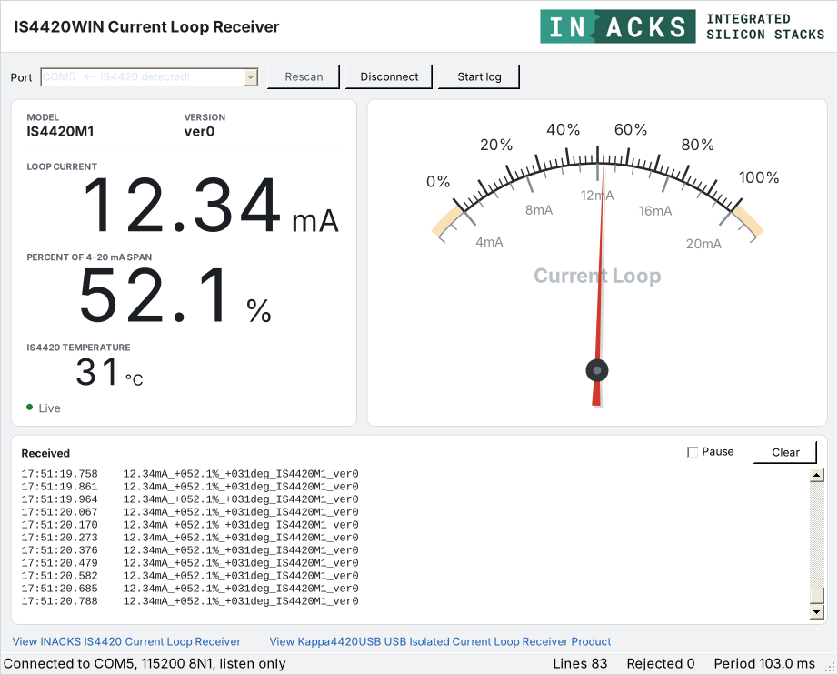
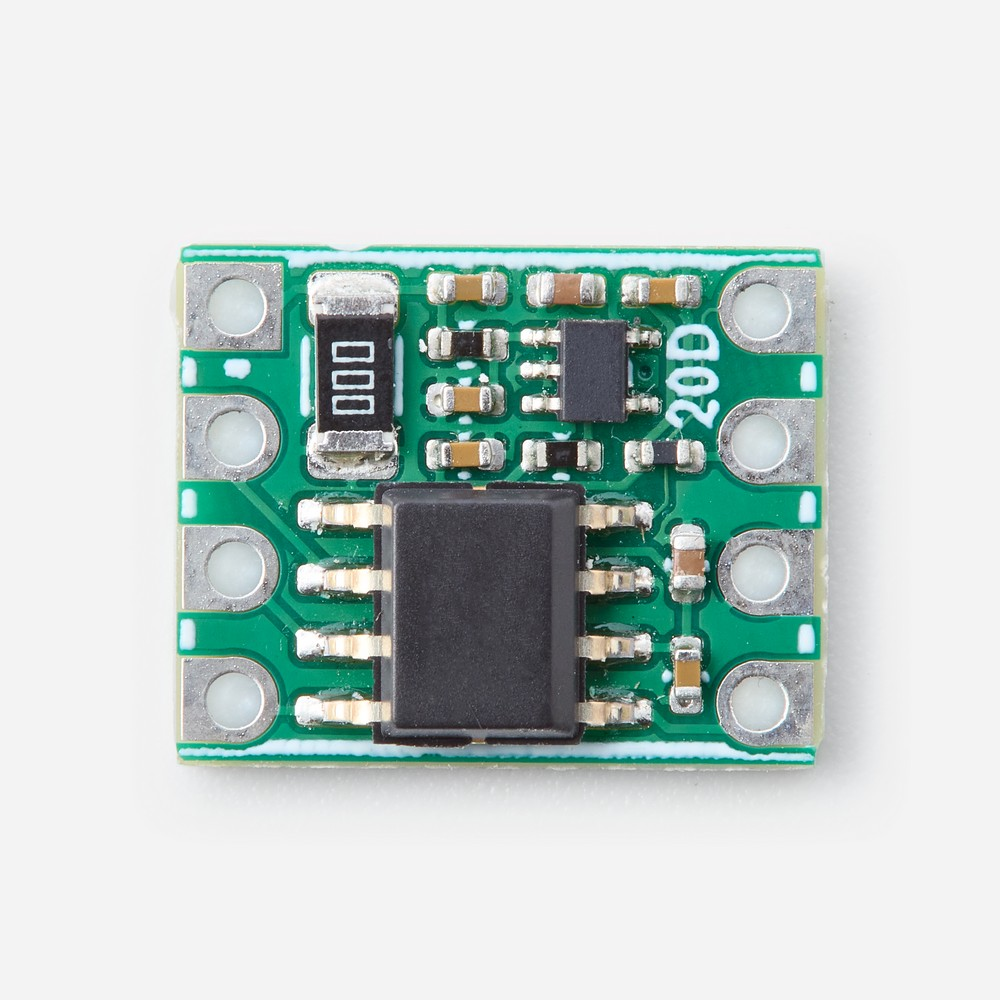
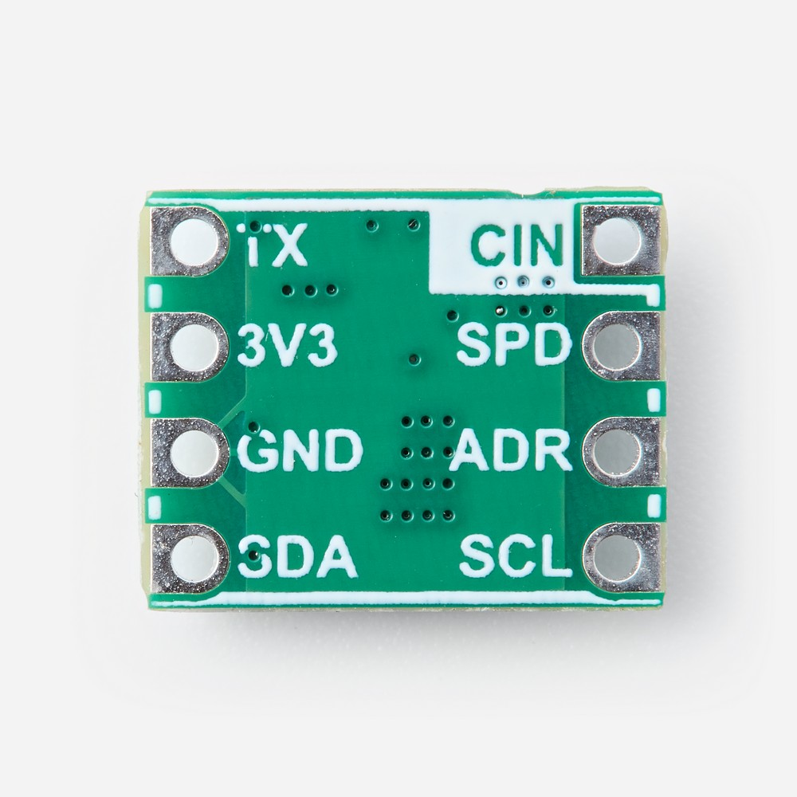

<p align="center">
  
</p>

<h1 align="center">IS4420WIN Current Loop Receiver</h1>

<p align="center">
  A free Windows program that shows a 4-20 mA current loop live on your PC,<br>
  measured by the INACKS <a href="https://inacks.com/is4420">IS4420-M1 I2C/UART 4-20 mA Current Loop Receiver</a>.
</p>

<p align="center">
  
</p>

<p align="center">
  <a href="https://github.com/inacks/IS4420WIN/releases/latest"><b>Download IS4420WIN</b></a>
  &nbsp;&nbsp;|&nbsp;&nbsp;
  <a href="https://inacks.com/is4420"><b>Get the IS4420-M1 module</b></a>
</p>

## What it does

- Shows the loop current in mA and the percentage of the 4-20 mA span in large digits, and the IS4420 temperature below them.
- Moves a needle gauge with the percentage, with the mA scale on the inside.
- Shows the model and the version the module reports.
- Keeps a log of every line received, and records everything to a CSV file when you press **Start log**.
- Finds the module by itself. When it starts, it listens on every free COM port and connects to the first one where an IS4420 is talking.

The program only listens. It never sends anything to the module.

## The IS4420-M1 module

<p align="center">
  <a href="https://inacks.com/is4420"></a>
  <a href="https://inacks.com/is4420"></a>
</p>

Reading a 4-20 mA current loop normally means designing your own measuring circuit, calibrating it, and turning voltages into currents in your own code. The IS4420-M1 does all of that for you in one small module. You connect the loop, give it 3.3 V, and read the current, ready to use:

- the current in mA, in 0.01 mA steps, and as a percentage of the 4-20 mA span, in 0.1 % steps, plus the module's own temperature;
- over I2C, and at the same time as a plain line of text on a UART output, about ten times a second;
- calibrated at the factory, so you can use the readings straight away;
- five I2C addresses (26 to 30) and three speeds (100 kHz, 400 kHz and 1 MHz), each chosen with one pad;
- I2C and TX pads that are 5 V tolerant, so it works with 3.3 V and 5 V hosts, an Arduino Uno included, without level shifters.

**[Buy the IS4420-M1 at inacks.com](https://inacks.com/is4420)**

**Rather not wire anything?** The [Kappa4420USB USB Isolated Current Loop Receiver](https://inacks.com/kappa4420usb) plugs straight into the PC. Connect the loop to it, and IS4420WIN reads it with nothing else to wire.

## What you need

- Windows 10 or 11. The program uses .NET Framework 4.5 or later, which comes with Windows, so there is nothing to install.
- An IS4420-M1 and a USB-UART adapter with 3.3 V or 5 V logic, or a Kappa4420USB.

## Wiring the IS4420-M1 to a USB-UART adapter

| IS4420-M1 pad | Connect to |
|---|---|
| TX | the adapter's RX, with a pull-up resistor of 2.2 kΩ (4.7 kΩ at most) to the adapter's logic supply, 3.3 V or 5 V. TX is open-drain and has no pull-up of its own. |
| 3V3 | 3.3 V |
| GND | the adapter's GND |
| CIN | the current loop, as the IS4420-M1 datasheet shows |

Connect the loop the right way round. CIN and 3V3 have no protection: a reversed loop, a loop supply connected straight to CIN, or a reversed supply destroys the module.

## Using the program

1. Download the zip from [Releases](https://github.com/inacks/IS4420WIN/releases/latest), unzip it, and double-click `IS4420WIN_v0.05.exe` (the number is the version). The first time, Windows may warn that the program is not signed: choose **More info**, then **Run anyway**.
2. The program listens on every free COM port for 0.6 s and connects by itself to the first port where it hears an IS4420. That port is marked `<-- IS4420 detected!` in the list.
3. If nothing is found, plug in the adapter or power the module. When a COM port appears or disappears, the program listens again and connects by itself. If the adapter was already plugged in, press **Rescan** (or F5).
4. **Disconnect** frees the port. The program then stays disconnected, and only marks the port where it hears the module, until you press **Connect** or **Rescan**.

`IS4420WIN_v0.05.exe COM7` connects to COM7 straight away, without listening on the other ports.

## The display

- **IS4420 temperature**: the temperature the module measures inside itself, in whole °C. It reads above the room temperature, because the module warms itself a little. It is not a value of the loop.
- **Over-range**: the module sends `EOVER`. Shown in red; the needle rests on the right stop. The temperature is still shown.
- **No measurement**: the module sends `ERROR` (and `ERR` for the temperature). Shown in amber; the needle returns to rest.
- **No valid line for 1 s**: the last values turn grey, with the time since the last line.
- **Adapter unplugged**: the program waits for the port and reconnects by itself when it comes back.

The needle scale runs from 2 to 22 mA (-12.5 % to 112.5 %). The shaded parts are outside 4-20 mA, and beyond the ends the needle rests on a stop.

## CSV log

**Start log** writes every valid line to `IS4420_log_<date>_<time>.csv` in the program's folder, until **Stop log**:

```
Date,Time,mA,%,degC,Model,Ver
2026-11-06,11:05:36.221,8.99,31.2,29,IS4420M1,ver0
2026-11-06,11:05:36.324,EOVER,EOVER,31,IS4420M1,ver0
2026-11-06,11:05:36.427,ERROR,ERROR,ERR,IS4420M1,ver0
```

Over-range and no-measurement lines have `EOVER` or `ERROR` in the mA and % columns. `degC` is the IS4420 temperature, `ERR` without a measurement. The status bar counts the rows. The program's folder must be writable, so don't run it from Program Files.

## The line the module sends

```
12.34mA_+052.1%_+025deg_IS4420M1_ver0<CR><LF>   39 bytes, 115200 8N1, about every 103 ms
EOVERmA_+EOVER%_+025deg_IS4420M1_ver0<CR><LF>   over-range (the temperature is still sent)
ERRORmA_+ERROR%_+ERRdeg_IS4420M1_ver0<CR><LF>   no measurement
```

The percentage has a `-` only below 4 mA, and the temperature has a `-` only below 0 °C. A line counts only if exactly 37 characters come before its CR LF and it has this format. The program also reads the shorter line of earlier firmware, which has no temperature. The log marks each line:

| Mark | Meaning |
|---|---|
| (none) | valid line |
| `x` | rejected, with the reason; counted in **Rejected** |
| `~` | partial line caught when the port opened; not counted |
| `!` | valid, but the mA and % fields disagree |
| `-` | message from the program |

**Period** in the status bar is the average time between the last 50 lines, measured with the PC clock. USB adapters deliver data in packets, so single lines jitter by several milliseconds; use a logic analyser for exact timing.

**Pause** freezes the log (lines are still counted), **Clear** empties it, Ctrl+C copies the selected lines and Ctrl+A selects them all.

## Notes

- The scan opens each free port for 0.6 s with DTR and RTS off, and sends nothing. Bluetooth COM ports are not scanned. Opening a port can still reset some boards connected to other ports (Arduino boards, for example). The program scans when it starts, when a COM port appears or disappears while it is disconnected, and when you press **Rescan**.
- The last port and the window position are kept in `%LOCALAPPDATA%\INACKS\IS4420WIN\settings.txt`, shared by every version of the program.

## Building from source

`build.bat` builds `IS4420WIN_<version>.exe` with the C# compiler that comes with .NET Framework 4.x (C# 5), then builds and runs `tests\LineTests.exe`. No Visual Studio is needed. The version comes from `AppInfo.Version` in `src\Support.cs`. The compiler prints a note that it only supports C# 5; the code is written for C# 5.

| Path | Content |
|---|---|
| `src\` | the program (C#, Windows Forms) |
| `tests\LineTests.cs` | tests of the line parser and the line reader. `LineTests.exe scan` lists what the scan hears on each port; `LineTests.exe link COM7 5` reads COM7 for 5 s. |
| `tests\fake_is4420.py` | a simulated IS4420-M1 output, for testing without a module (Python 3; on Windows it needs pyserial and a virtual COM port pair such as com0com) |
| `tools\make_icon.py` | draws the program icon |
| `docs\` | the pictures in this page |

## License

MIT, see [LICENSE](LICENSE). Copyright (c) 2026 INACKS.
